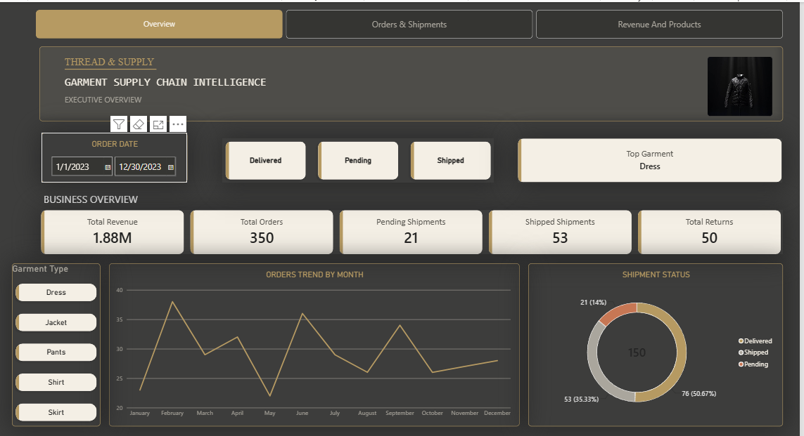
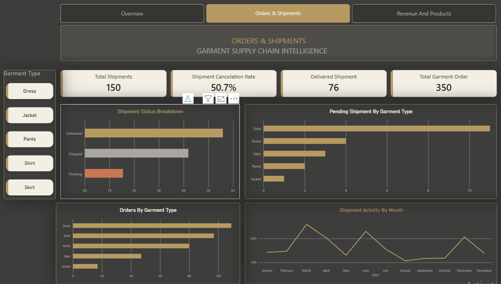
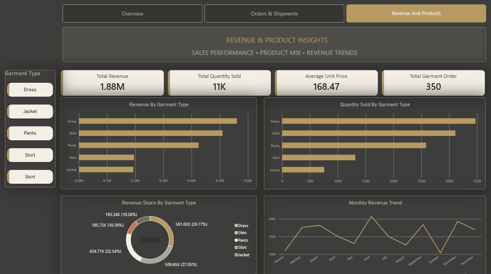

# THREAD & SUPPLY
### Garment Supply Chain Intelligence | Power BI

An interactive Power BI dashboard designed to analyse garment orders, shipments, pending deliveries, revenue, and product performance.

## Dashboard Pages

### 1. Overview
- Key performance indicators (KPIs)
- Monthly order trends
- Shipment status breakdown
- Interactive filters for dates, shipment status, and garment types

### 2. Orders & Shipments
- Shipment completion rate
- Shipment activity by month
- Pending shipments by garment type
- Orders by garment type
- Shipment status analysis

### 3. Revenue & Products
- Total revenue and quantity sold
- Average unit price
- Revenue by garment type
- Monthly revenue trends
- Revenue share by garment type

## Tools & Skills
- Microsoft Power BI
- Power Query
- Data Modelling
- DAX Measures
- Data Visualisation
- Business Intelligence

## Project Objective
To transform garment supply chain data into an interactive dashboard that helps users explore order performance, shipment progress, and product revenue.

## Dashboard Preview

### 1. Overview

### 2. Orders & Shipments

### 3. Revenue & Products

## Author
Ankur Srivastava

**Focus Areas:** Data Analytics | Power BI | SQL | Excel
